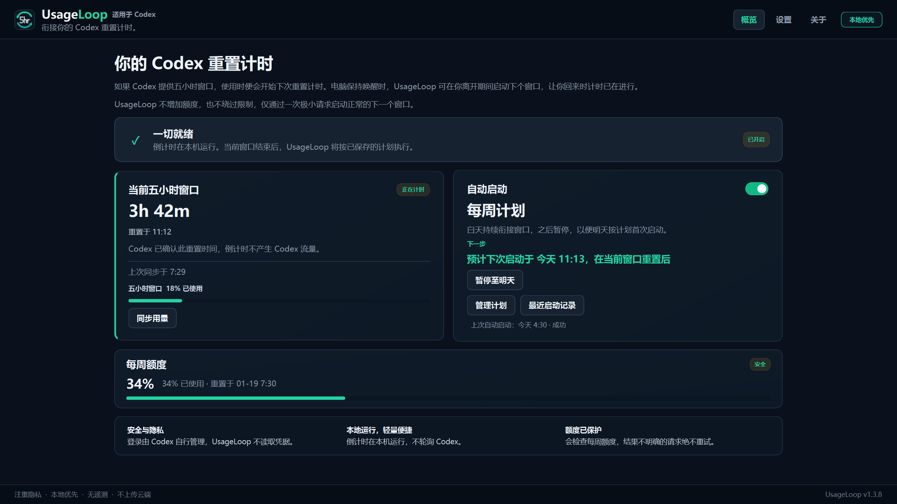
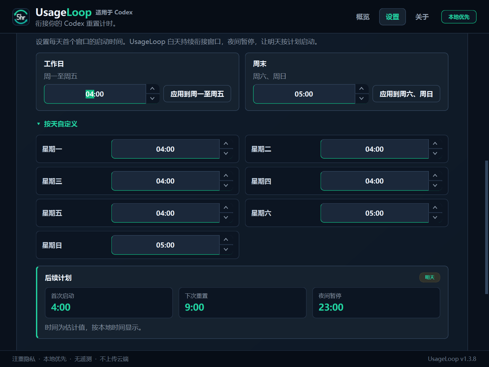

# UsageLoop：Codex 五小时窗口启动计划工具

[English](README.md) | 简体中文

**安排每天何时开始 Codex 的额度窗口计时。**

对于提供五小时用量窗口的 Codex 账号，上一个窗口结束后，下次重置计时通常从你的下一次请求开始。例如早上 7 点首次使用，下次重置约在中午；如果凌晨 4 点开始，下次重置约在上午 9 点。

UsageLoop 可以按计划发送一次极小的 Codex 请求，启动正常的下一个窗口。该请求会消耗少量订阅额度。你可以设置每天相同的时间、分别设置工作日和周末，或为一周七天各自设置时间。每周计划会在白天衔接窗口、夜间暂停，以配合次日的首次启动。

UsageLoop **不会增加额度、绕过限制、购买积分、提前重置正在运行的窗口或重置每周额度**。没有五小时窗口的账号不适用此计划功能。

## 简体中文界面

在“设置 → 语言”中选择“简体中文”，退出应用后重新打开即可生效。关闭主窗口可能只会最小化到托盘；需要通过托盘菜单退出。也可以选择 English 或跟随系统；简体中文系统使用中文，其他系统回退到英文。

语言更改不会开启自动启动、改变已有计划或发送 Codex 请求。中文时间输入使用 24 小时制，日期按本地时间显示。

本文包含开发分支新增的中文界面说明，已发布的安装包未必包含此功能。



## 安装与运行条件

- Windows x64 或带图形桌面的 Linux x86_64。
- 已安装并登录 Codex，可通过 ChatGPT 桌面应用的 Codex 模式或 Codex CLI 使用。
- 按计划启动时，电脑必须保持唤醒、用户已登录，且 UsageLoop 正在运行。
- 无需 API Key。自动启动和登录时启动默认关闭。

从项目的 [Releases 页面](https://github.com/benthompsondev/usageloop/releases/latest) 下载适合系统的安装包，以及对应的 `.sha256` 校验文件。

Windows 安装程序目前未签名，请先核对下载来源和 SHA-256。组织策略禁止运行未签名应用时，不要绕过策略。安装不需要管理员权限，不修改全局 PATH。

在包含两个下载文件的 PowerShell 目录中校验：

```powershell
$expected = (Get-Content .\UsageLoop-Setup.exe.sha256).Split()[0]
$actual = (Get-FileHash .\UsageLoop-Setup.exe -Algorithm SHA256).Hash.ToLower()
$actual -eq $expected
```

结果应为 `True`。Linux 请下载压缩包和匹配的校验文件，按 [英文安装说明](README.md#linux) 校验、解压并运行 `install.sh`，无需 root 权限。

更新仅在手动点击“检查更新”后检查 GitHub；下载通过校验后才会进入安装流程，不会在后台自行安装更新。

## 设置计划

| 模式 | 行为 |
| --- | --- |
| 连续启动 | 当前窗口重置并经过安全缓冲期后，检查并启动下一个窗口。 |
| 每天一次 | 当前窗口结束后，等待所选的本地时间。 |
| 每周计划 | 按天设置首次启动时间，白天衔接窗口，夜间暂停，为次日计划留出时间。 |

先选择计划，再开启“自动启动”。首次窗口可使用“立即启动首个窗口”，此操作需要确认且会消耗少量额度。电脑唤醒或应用重启后只检查当前计划，不会逐次补发错过的启动。

“最近启动记录”展示最多 10 次尝试及其结果，包括已确认、未发送或结果不明确。请求可能已发送而结果不明确时，UsageLoop 不会自动重试。启动成功也不代表一定还有可用额度。



## 工作方式与隐私

UsageLoop 通过本机 Codex app-server 读取用量和客户端能力。自动启动前会检查多次观察结果、已确认的重置时间、安全缓冲期、每周额度、重复尝试记录及兼容性。启动仅使用一次临时会话和一次极小请求，不使用工具。

模型选择及完整安全规则请参阅 [工作原理](README.md#how-it-works)。模型目录由已安装的 Codex 客户端提供；没有支持的轻量模型时不发送请求，不改用成本更高的模型。Codex app-server 接口仍可能变化，更新 Codex 后可能需要兼容性修复。

按照项目的设计，应用不读取 Codex 凭据、令牌、对话、提示词、回答或账号标识，无遥测、无需云账号。窗口状态、计划和启动记录在本机保存。语言偏好通过 Qt 的用户设置保存，独立于调度状态。

本项目为独立开源项目，与 OpenAI 无隶属关系，亦未获其背书或赞助。

## 问题反馈

更新或重新登录 Codex 后，可使用“设置 → Codex 连接 → 重新检查 Codex 兼容性”。此检查仅读取用量和支持的模型，不发送模型请求，不重试结果不明确的启动。

- [报告问题](https://github.com/benthompsondev/usageloop/issues/new?template=bug_report.yml)
- [建议新功能](https://github.com/benthompsondev/usageloop/issues/new?template=feature_request.yml)

问题报告可附上“技术详情 → 复制此摘要”的内容。诊断标识和复制用的技术摘要保留英文，便于维护者排查。发布说明保留作者原文。不要粘贴凭据、账号信息、Codex 对话或无关日志。

## 从源码运行与贡献翻译

需要 Python 3.11 或更新版本。Windows：

```powershell
python -m venv .venv
.\.venv\Scripts\python -m pip install --editable ".[test]"
.\.venv\Scripts\usageloop
```

运行验证：

```powershell
$env:QT_QPA_PLATFORM = 'offscreen'
pwsh -NoProfile -File .\scripts\verify.ps1
```

Linux 构建命令见 [英文开发说明](README.md#advanced-use-and-development)。新增或修改翻译的方法见 [本地化开发说明](docs/LOCALIZATION.md)。

代码采用 [MIT 许可证](LICENSE)。修改和分发时请保留版权声明与许可证；第三方依赖仍适用各自许可证。
